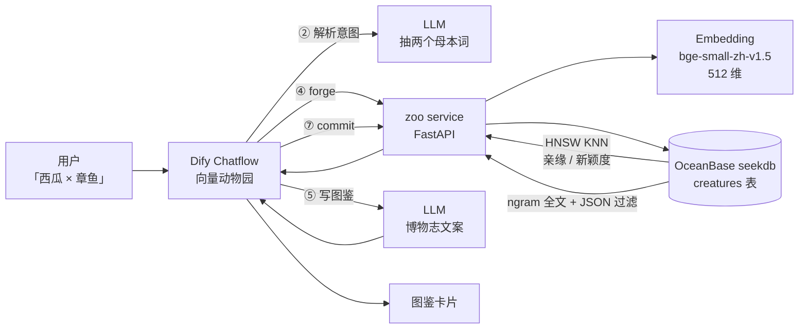

# 架构：一只物种是怎么诞生的

## 全景



## 三个角色，各干各的

| 角色 | 负责 | 不负责 |
| --- | --- | --- |
| **Dify** | 理解自然语言、决定母本与比例、撰写图鉴文案、多轮对话 | 不算向量、不存数据 |
| **zoo service** | embedding、基因混合、突变、稀有度、把 SQL 组织出来 | 不写文案（除了兜底模板） |
| **seekdb** | 存基因组（VECTOR）、图鉴（TEXT/JSON）、算余弦距离与全文得分 | 不做生成 |

这样切的理由很实际：**Dify 的强项是编排和生成，seekdb 的强项是一次查询里同时做向量、全文、结构化过滤**。把 512 维数组在 Dify 节点之间来回搬，既慢又容易在 JSON 里被转义搞坏，所以服务端用 `forge → token → commit` 两段式把向量留在服务侧。

## 数据流

### A. 造一只新物种（create）

1. 用户说「做个会飞的西瓜和章鱼的混种」；
2. Dify 的 LLM 抽出 `a=西瓜, b=章鱼, ratio=0.5`；
3. `POST /api/dify/forge`：
   - `embed([西瓜, 章鱼])` → 两个 512 维单位向量；
   - `genome = normalize(0.5·va + 0.5·vb + 0.08·noise)`，噪声由 `sha256(a|b|mutation)` 播种，**同样的输入必然得到同样的基因组**；
   - `SELECT ... ORDER BY COSINE_DISTANCE(genome, :vec) APPROXIMATE LIMIT 4` 找最近的亲戚；
   - 新颖度 = 最近距离；再算它在全园的分位 → 稀有度（传说/稀有/少见/常见）；
   - 8 条基因轴 = 基因组投影到固定随机正交基上再过 sigmoid；
   - 结果暂存，返回 `token` + 基因轴 + 亲戚 + 稀有度；
4. Dify 的 LLM 拿着「母本 + 基因轴 + 亲戚」写图鉴 JSON；
5. `POST /api/dify/commit`：把基因组、图鉴、元数据一次性写进 `creatures`。

### B. 杂交（breed）

两个已存在物种的基因组各取一半 + 更高的突变率，`generation = max(父, 母) + 1`，`parents = [id_a, id_b]`。稀有度同样由"与全园最近距离"决定，所以**杂交越跨谱系，后代越稀有**。

### C. 检索（search）

一条 SQL 同时算两种分数，再叠加 JSON 过滤：

```sql
SELECT *, 0.62 * (1 - dist) + 0.38 * LEAST(IFNULL(text_score, 0), 1) AS score
FROM (
  SELECT id, code, name, latin, tagline, rarity, traits,
         COSINE_DISTANCE(genome, :vec) AS dist,
         MATCH(name, latin, tagline, lore) AGAINST(:q) AS text_score
  FROM creatures
  WHERE traits->>'$.habitat' = :habitat
) ranked
ORDER BY score DESC
LIMIT 8;
```

这就是 seekdb 相对"Postgres + ES + Redis"三件套的价值：**一个库、一条 SQL、一次事务**。

## 表结构

```sql
CREATE TABLE creatures (
  id BIGINT AUTO_INCREMENT PRIMARY KEY,
  code VARCHAR(16),              -- 图鉴编号 ZK-0001
  name VARCHAR(64),
  seeds JSON,                    -- 母本词
  genome VECTOR(512),            -- 基因组
  axes JSON,                     -- 8 条基因轴
  traits JSON,                   -- 栖息地 / 食性 / 稀有度
  lore TEXT,
  rarity VARCHAR(16),
  novelty FLOAT,                 -- 与已有种群的最近距离
  parents JSON, generation INT,
  VECTOR INDEX idx_genome (genome) WITH (distance=cosine, type=hnsw, m=16, ef_construction=200),
  FULLTEXT INDEX idx_text (name, latin, tagline, lore) WITH PARSER ngram
);
```

## 为什么"必须"是 seekdb

| 玩法 | 依赖的数据库能力 | 换成普通向量库会怎样 |
| --- | --- | --- |
| 亲缘 / 新颖度 / 稀有度 | HNSW KNN + 距离函数 | 要自己维护向量服务 |
| 图鉴关键词检索 | 中文 ngram 全文索引 | 得再上一套 ES |
| 按栖息地/稀有度筛选 | JSON 列 + 索引 | 得把元数据同步到别处 |
| 生态统计（分布、多样性） | 聚合查询 | 得导出去算 |
| 与 Dify 同库 | MySQL 协议 / MetaDB 兼容 | 两套存储两套备份 |

## 扩展点

- **图片生成**：图鉴卡片接文生图（ComfyUI / 通义万相），按基因组 seed 保证可复现；
- **种群演化**：定时任务批量杂交，画基因距离的演化树；
- **多人动物园**：`user_id` 进 scope，每人一个独立基因池；
- **Dify 知识库**：把图鉴正文写成文档喂给 Dify 知识库，做成"动物园讲解员"。
